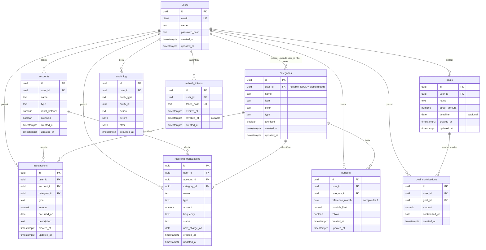

# Fôlego — Modelagem Inicial do Banco de Dados

> Derivado do `docs/architecture.md` aprovado. Nenhum código Java aqui — apenas modelagem e SQL de migration.
> PostgreSQL 16+. PKs em UUID, dinheiro em `NUMERIC(14,2)`, instantes em `timestamptz` UTC, datas de domínio em `date`.
> Nota: o ADR-001 do `architecture.md` foi atualizado para **`NUMERIC(14,2)`** — documentos alinhados, sem pendência.

---

## 1. DER (Mermaid)



---

## 2. Tabelas em detalhe

Convenções gerais (valem para todas e não são repetidas linha a linha):
- PK `id uuid DEFAULT gen_random_uuid()` (pgcrypto/built-in no PG 13+; sem dependência de extensão extra com `gen_random_uuid()` nativo).
- `created_at`/`updated_at` `timestamptz NOT NULL DEFAULT now()` — instantes de sistema sempre UTC (ADR-002).
- Toda tabela de dados do usuário tem `user_id NOT NULL REFERENCES users(id)` com índice — base do isolamento absoluto (ADR-005).
- Enums de domínio como `CHECK` em `text` (não `CREATE TYPE`): evolução sem `ALTER TYPE` (migração mais simples) e mapeamento JPA direto como `String`/enum Java.

### 2.1 `users`

| Coluna | Tipo | Regras |
|---|---|---|
| id | uuid | PK |
| email | citext | NOT NULL, UNIQUE |
| name | text | NOT NULL |
| password_hash | text | NOT NULL |
| created_at / updated_at | timestamptz | NOT NULL DEFAULT now() |

Justificativas:
- `citext` no e-mail: unicidade case-insensitive no banco (João@x.com = joao@x.com), em vez de depender de normalização na aplicação.
- `password_hash` em `text`: BCrypt tem tamanho variável por versão/cost; sem limite artificial.
- Minimização LGPD: apenas e-mail e nome — nenhum outro dado pessoal.

Índices: o UNIQUE de `email` já cria o índice de login.

### 2.2 `accounts`

| Coluna | Tipo | Regras |
|---|---|---|
| id | uuid | PK |
| user_id | uuid | NOT NULL, FK → users(id) ON DELETE CASCADE |
| name | text | NOT NULL |
| type | text | NOT NULL, CHECK in ('conta','dinheiro','cartao') |
| initial_balance | NUMERIC(14,2) | NOT NULL DEFAULT 0 |
| archived | boolean | NOT NULL DEFAULT false |
| created_at / updated_at | timestamptz | NOT NULL DEFAULT now() |

Constraints/índices:
- `UNIQUE (user_id, name)` — evita contas duplicadas com o mesmo nome para o mesmo titular.
- Índice `(user_id)` — toda listagem é por usuário.

Justificativas:
- `initial_balance` pode ser negativo (cartão com fatura aberta) — sem CHECK de positividade aqui, por decisão de domínio.
- `archived` (soft delete, ADR-003): contas são referenciadas por transações históricas; arquivar preserva o histórico.
- Saldo atual NÃO é coluna: é derivado (inicial + transações), conforme §3 da arquitetura.

### 2.3 `categories`

| Coluna | Tipo | Regras |
|---|---|---|
| id | uuid | PK |
| user_id | uuid | **NULLABLE**, FK → users(id) ON DELETE CASCADE |
| name | text | NOT NULL |
| icon | text | NOT NULL |
| color | text | NOT NULL, CHECK formato `#RRGGBB` |
| type | text | NOT NULL, CHECK in ('gasto','receita') |
| archived | boolean | NOT NULL DEFAULT false |
| created_at / updated_at | timestamptz | NOT NULL DEFAULT now() |

**Modelo global vs por usuário:** `user_id IS NULL` ⇒ categoria **global** (seed, somente leitura para usuários); `user_id` preenchido ⇒ categoria **do usuário**. Regras de aplicação: usuário não edita/arquiva categoria global; pode criar as próprias. Justificativa: evita duplicar as 8 categorias padrão para cada usuário novo (sem job de cópia no registro) e mantém um vocabulário comum para análises; o custo é o `user_id` nullable, mitigado pelos índices parciais abaixo.

Constraints/índices:
- `UNIQUE (user_id, lower(name))` via índice único parcial `WHERE user_id IS NOT NULL` — nome único por usuário, case-insensitive.
- Índice único parcial `lower(name) WHERE user_id IS NULL` — globais também não se duplicam (UNIQUE comum não pega NULLs).
- `CHECK (color ~ '^#[0-9a-fA-F]{6}$')` — integridade do hex no banco, não só na borda.
- Índice `(user_id)`.

### 2.4 `transactions`

| Coluna | Tipo | Regras |
|---|---|---|
| id | uuid | PK |
| user_id | uuid | NOT NULL, FK → users(id) ON DELETE CASCADE |
| account_id | uuid | NOT NULL, FK → accounts(id) ON DELETE RESTRICT |
| category_id | uuid | NOT NULL, FK → categories(id) ON DELETE RESTRICT |
| type | text | NOT NULL, CHECK in ('entrada','saida') |
| amount | NUMERIC(14,2) | NOT NULL, CHECK (amount > 0) |
| occurred_on | date | NOT NULL |
| description | text | NOT NULL DEFAULT '' |
| created_at / updated_at | timestamptz | NOT NULL DEFAULT now() |

Justificativas:
- `amount > 0` com `type` definindo o sinal: um único invariante simples; evita o estado ambíguo "saída com valor negativo".
- `occurred_on date` (não timestamptz): transação é conceito de **dia** — elimina o bug de "mudar de dia" por fuso (ADR-002). `created_at` registra o instante real de criação para auditoria.
- FKs de conta/categoria com `RESTRICT`: não se apaga conta/categoria com lançamentos — o fluxo correto é arquivar (ADR-003).
- A posse cruzada (conta e categoria pertencerem ao MESMO user da transação) é invariante de service (validação na escrita), pois CHECK não atravessa tabelas e trigger adicionaria lógica fora do trilho testável.

Índices:
- `(user_id, occurred_on DESC)` — query dominante: extrato do mês por usuário.
- `(user_id, category_id, occurred_on)` — agregações de orçamento/gastos por categoria.
- `(account_id)` — derivação de saldo por conta.

### 2.5 `budgets`

| Coluna | Tipo | Regras |
|---|---|---|
| id | uuid | PK |
| user_id | uuid | NOT NULL, FK → users(id) ON DELETE CASCADE |
| category_id | uuid | NOT NULL, FK → categories(id) ON DELETE RESTRICT |
| reference_month | date | NOT NULL, CHECK (dia = 1) |
| monthly_limit | NUMERIC(14,2) | NOT NULL, CHECK (> 0) |
| rollover | boolean | NOT NULL DEFAULT false |
| created_at / updated_at | timestamptz | NOT NULL DEFAULT now() |

Constraints/índices:
- **`UNIQUE (user_id, category_id, reference_month)`** — um orçamento por categoria por mês por usuário (núcleo do requisito).
- `CHECK (reference_month = date_trunc('month', reference_month)::date)` — mês de referência canônico como dia 1; evita dois registros "do mesmo mês" com dias diferentes burlando o UNIQUE.
- Índice `(user_id, reference_month)` — carregar o orçamento do mês inteiro de uma vez.

Justificativas:
- `reference_month` como `date` (dia 1) em vez de `text 'YYYY-MM'` ou colunas (ano, mês): ordena e compara nativamente, e funções de data do PG funcionam direto.
- `rollover` default `false`: opt-in, paridade com o comportamento atual do app.

### 2.6 `recurring_transactions`

| Coluna | Tipo | Regras |
|---|---|---|
| id | uuid | PK |
| user_id | uuid | NOT NULL, FK → users(id) ON DELETE CASCADE |
| account_id | uuid | NOT NULL, FK → accounts(id) ON DELETE RESTRICT |
| category_id | uuid | NOT NULL, FK → categories(id) ON DELETE RESTRICT |
| name | text | NOT NULL |
| type | text | NOT NULL, CHECK in ('entrada','saida') |
| amount | NUMERIC(14,2) | NOT NULL, CHECK (> 0) |
| frequency | text | NOT NULL, CHECK in ('semanal','mensal','anual') |
| status | text | NOT NULL DEFAULT 'ativo', CHECK in ('ativo','cancelado') |
| next_charge_on | date | NOT NULL |
| created_at / updated_at | timestamptz | NOT NULL DEFAULT now() |

Justificativas:
- Template, não fato (ADR-006): nenhuma coluna de "última execução" — materializações viram `transactions` auditadas.
- `status` como CHECK (não boolean `active`): aberto a estados futuros (ex.: 'pausado') sem mudança de tipo.
- Frequências espelham o frontend atual (semanal/mensal/anual) — sem 'diaria' por ora; adicionar é só ampliar o CHECK.

Índices: `(user_id, status)` — a consulta padrão é "recorrentes ativos do usuário"; `(user_id, next_charge_on)` para materialização por vencimento.

### 2.7 `goals`

| Coluna | Tipo | Regras |
|---|---|---|
| id | uuid | PK |
| user_id | uuid | NOT NULL, FK → users(id) ON DELETE CASCADE |
| name | text | NOT NULL |
| target_amount | NUMERIC(14,2) | NOT NULL, CHECK (> 0) |
| deadline | date | NULLABLE |
| created_at / updated_at | timestamptz | NOT NULL DEFAULT now() |

Justificativas:
- **Sem coluna `current_amount`**: o valor atual é derivado de `goal_contributions` (mesmo princípio do saldo de conta — fato agregável, não estado redundante). O frontend atual guarda `valorAtual`; na migração de dados ele vira um aporte inicial (ver §5).
- `deadline` nullable: prazo é opcional por requisito.

Índices: `(user_id)`.

### 2.8 `goal_contributions`

| Coluna | Tipo | Regras |
|---|---|---|
| id | uuid | PK |
| user_id | uuid | NOT NULL, FK → users(id) ON DELETE CASCADE |
| goal_id | uuid | NOT NULL, FK → goals(id) ON DELETE CASCADE |
| amount | NUMERIC(14,2) | NOT NULL, CHECK (<> 0) |
| contributed_on | date | NOT NULL DEFAULT CURRENT_DATE |
| created_at | timestamptz | NOT NULL DEFAULT now() |

Justificativas:
- `amount <> 0` permitindo negativo: retirada de meta é aporte negativo — um único mecanismo auditável para entrada e saída da reserva.
- `user_id` redundante com `goal.user_id` de propósito: mantém a regra "toda tabela de dados do usuário filtra por user_id" sem JOIN — defesa em profundidade contra IDOR.
- Sem `updated_at`: aporte é fato imutável; correção = estorno (novo aporte negativo), preservando trilha.
- `ON DELETE CASCADE` de `goal_id`: aporte não tem sentido sem a meta; o estado anterior fica no `audit_log`.

Índices: `(goal_id)`, `(user_id)`.

### 2.9 `audit_log`

| Coluna | Tipo | Regras |
|---|---|---|
| id | uuid | PK |
| user_id | uuid | NULLABLE, FK → users(id) ON DELETE SET NULL |
| entity_type | text | NOT NULL |
| entity_id | uuid | NOT NULL |
| action | text | NOT NULL, CHECK in ('INSERT','UPDATE','DELETE') |
| before | jsonb | NULLABLE (NULL em INSERT) |
| after | jsonb | NULLABLE (NULL em DELETE) |
| occurred_at | timestamptz | NOT NULL DEFAULT now() |

Constraints/índices:
- **Índice `(entity_type, entity_id)`** — requisito: reconstituir a história de um registro.
- Índice `(user_id, occurred_at DESC)` — trilha por titular em ordem cronológica.
- `CHECK ((action = 'INSERT' AND before IS NULL) OR (action = 'DELETE' AND after IS NULL) OR (action = 'UPDATE' AND before IS NOT NULL AND after IS NOT NULL))` — coerência estrutural do par before/after por ação.

Justificativas:
- `user_id` **nullable com `ON DELETE SET NULL`**: na exclusão LGPD o vínculo identificador é cortado, mas o evento (já anonimizado no payload pela aplicação) permanece — auditoria sobrevive sem reter dado pessoal.
- Append-only é garantido em duas camadas: sem endpoints de mutação + `REVOKE UPDATE, DELETE` para o role da aplicação (no SQL da migration).
- Sem `updated_at`: registro imutável por definição.

### 2.10 `refresh_tokens`

| Coluna | Tipo | Regras |
|---|---|---|
| id | uuid | PK |
| user_id | uuid | NOT NULL, FK → users(id) ON DELETE CASCADE |
| token_hash | text | NOT NULL, UNIQUE |
| expires_at | timestamptz | NOT NULL |
| revoked_at | timestamptz | NULLABLE |
| created_at | timestamptz | NOT NULL DEFAULT now() |

Justificativas:
- `token_hash` (nunca o token em claro): vazamento do banco não compromete sessões ativas — mesmo racional do hash de senha.
- **Sem `updated_at`**: o registro é imutável exceto pela revogação, que seta `revoked_at` uma única vez; a rotação cria registro novo e revoga o anterior.
- Auditoria de autenticação (§6 da arquitetura): login = INSERT deste registro no `audit_log`; logout/revogação/rotação = DELETE — sem ação "LOGIN" dedicada.
- `ON DELETE CASCADE`: exclusão do titular (LGPD) derruba também as sessões.

Índices: `(user_id)` — revogar todas as sessões do usuário; o UNIQUE de `token_hash` já cria o índice de lookup do refresh.

---

## 3. Estratégia de exclusão (ON DELETE por FK)

| FK | Regra | Racional |
|---|---|---|
| `*.user_id → users` (todas de domínio) | **CASCADE** | Exclusão do titular (LGPD) derruba todo o grafo de dados financeiros em uma operação atômica. |
| `audit_log.user_id → users` | **SET NULL** | Trilha de auditoria sobrevive anonimizada; payloads são anonimizados pela aplicação ANTES do delete. |
| `transactions.account_id → accounts` | **RESTRICT** | Conta com lançamentos não pode sumir; fluxo correto é `archived = true`. |
| `transactions.category_id → categories` | **RESTRICT** | Idem; categoria referenciada se arquiva, não se apaga. |
| `budgets.category_id → categories` | **RESTRICT** | Orçamento sem categoria é incoerente; arquivamento mantém o histórico. |
| `recurring_transactions.account_id / category_id` | **RESTRICT** | Mesmo racional das transações. |
| `goal_contributions.goal_id → goals` | **CASCADE** | Aporte é parte da meta; estado anterior preservado no audit_log. |
| `refresh_tokens.user_id → users` | **CASCADE** | Sessões não sobrevivem ao titular; exclusão LGPD encerra tudo. |

**Fluxo de exclusão do titular (LGPD), em uma transação:**
1. Aplicação anonimiza payloads do `audit_log` do titular (substitui identificadores por pseudônimo irreversível).
2. `DELETE FROM users WHERE id = :id` — CASCADE remove accounts, categories próprias, transactions, budgets, recurring_transactions, goals e goal_contributions; `audit_log.user_id` vira NULL via SET NULL.
3. Registra evento final de exclusão no `audit_log` (entity_type 'users', action 'DELETE', payload anonimizado).

Categorias **globais** (`user_id IS NULL`) não pertencem a ninguém e nunca são afetadas por exclusão de titular.

---

## 4. Migrations Flyway

### V1__schema_inicial.sql

```sql
-- Fôlego — schema inicial
-- PKs em UUID, dinheiro em NUMERIC(14,2), instantes em timestamptz (UTC), datas de domínio em date.

CREATE EXTENSION IF NOT EXISTS citext;

-- ---------------------------------------------------------------------------
-- users
-- ---------------------------------------------------------------------------
CREATE TABLE users (
    id            uuid PRIMARY KEY DEFAULT gen_random_uuid(),
    email         citext      NOT NULL UNIQUE,
    name          text        NOT NULL,
    password_hash text        NOT NULL,
    created_at    timestamptz NOT NULL DEFAULT now(),
    updated_at    timestamptz NOT NULL DEFAULT now()
);

-- ---------------------------------------------------------------------------
-- accounts
-- ---------------------------------------------------------------------------
CREATE TABLE accounts (
    id              uuid PRIMARY KEY DEFAULT gen_random_uuid(),
    user_id         uuid          NOT NULL REFERENCES users (id) ON DELETE CASCADE,
    name            text          NOT NULL,
    type            text          NOT NULL CHECK (type IN ('conta', 'dinheiro', 'cartao')),
    initial_balance numeric(14,2) NOT NULL DEFAULT 0,
    archived        boolean       NOT NULL DEFAULT false,
    created_at      timestamptz   NOT NULL DEFAULT now(),
    updated_at      timestamptz   NOT NULL DEFAULT now(),
    CONSTRAINT uq_accounts_user_name UNIQUE (user_id, name)
);

CREATE INDEX idx_accounts_user ON accounts (user_id);

-- ---------------------------------------------------------------------------
-- categories  (user_id NULL = categoria global de seed)
-- ---------------------------------------------------------------------------
CREATE TABLE categories (
    id         uuid PRIMARY KEY DEFAULT gen_random_uuid(),
    user_id    uuid        REFERENCES users (id) ON DELETE CASCADE,
    name       text        NOT NULL,
    icon       text        NOT NULL,
    color      text        NOT NULL CHECK (color ~ '^#[0-9a-fA-F]{6}$'),
    type       text        NOT NULL CHECK (type IN ('gasto', 'receita')),
    archived   boolean     NOT NULL DEFAULT false,
    created_at timestamptz NOT NULL DEFAULT now(),
    updated_at timestamptz NOT NULL DEFAULT now()
);

CREATE INDEX idx_categories_user ON categories (user_id);
-- nome único por usuário (case-insensitive); UNIQUE comum ignora NULLs, então: parcial
CREATE UNIQUE INDEX uq_categories_user_name
    ON categories (user_id, lower(name)) WHERE user_id IS NOT NULL;
-- globais também não se duplicam
CREATE UNIQUE INDEX uq_categories_global_name
    ON categories (lower(name)) WHERE user_id IS NULL;

-- ---------------------------------------------------------------------------
-- transactions
-- ---------------------------------------------------------------------------
CREATE TABLE transactions (
    id          uuid PRIMARY KEY DEFAULT gen_random_uuid(),
    user_id     uuid          NOT NULL REFERENCES users (id)      ON DELETE CASCADE,
    account_id  uuid          NOT NULL REFERENCES accounts (id)   ON DELETE RESTRICT,
    category_id uuid          NOT NULL REFERENCES categories (id) ON DELETE RESTRICT,
    type        text          NOT NULL CHECK (type IN ('entrada', 'saida')),
    amount      numeric(14,2) NOT NULL CHECK (amount > 0),
    occurred_on date          NOT NULL,
    description text          NOT NULL DEFAULT '',
    created_at  timestamptz   NOT NULL DEFAULT now(),
    updated_at  timestamptz   NOT NULL DEFAULT now()
);

CREATE INDEX idx_transactions_user_date     ON transactions (user_id, occurred_on DESC);
CREATE INDEX idx_transactions_user_cat_date ON transactions (user_id, category_id, occurred_on);
CREATE INDEX idx_transactions_account       ON transactions (account_id);

-- ---------------------------------------------------------------------------
-- budgets  (um por user + categoria + mês; reference_month canônico no dia 1)
-- ---------------------------------------------------------------------------
CREATE TABLE budgets (
    id              uuid PRIMARY KEY DEFAULT gen_random_uuid(),
    user_id         uuid          NOT NULL REFERENCES users (id)      ON DELETE CASCADE,
    category_id     uuid          NOT NULL REFERENCES categories (id) ON DELETE RESTRICT,
    reference_month date          NOT NULL
        CHECK (reference_month = date_trunc('month', reference_month)::date),
    monthly_limit   numeric(14,2) NOT NULL CHECK (monthly_limit > 0),
    rollover        boolean       NOT NULL DEFAULT false,
    created_at      timestamptz   NOT NULL DEFAULT now(),
    updated_at      timestamptz   NOT NULL DEFAULT now(),
    CONSTRAINT uq_budgets_user_cat_month UNIQUE (user_id, category_id, reference_month)
);

CREATE INDEX idx_budgets_user_month ON budgets (user_id, reference_month);

-- ---------------------------------------------------------------------------
-- recurring_transactions  (templates; materialização explícita vira transaction)
-- ---------------------------------------------------------------------------
CREATE TABLE recurring_transactions (
    id             uuid PRIMARY KEY DEFAULT gen_random_uuid(),
    user_id        uuid          NOT NULL REFERENCES users (id)      ON DELETE CASCADE,
    account_id     uuid          NOT NULL REFERENCES accounts (id)   ON DELETE RESTRICT,
    category_id    uuid          NOT NULL REFERENCES categories (id) ON DELETE RESTRICT,
    name           text          NOT NULL,
    type           text          NOT NULL CHECK (type IN ('entrada', 'saida')),
    amount         numeric(14,2) NOT NULL CHECK (amount > 0),
    frequency      text          NOT NULL CHECK (frequency IN ('semanal', 'mensal', 'anual')),
    status         text          NOT NULL DEFAULT 'ativo' CHECK (status IN ('ativo', 'cancelado')),
    next_charge_on date          NOT NULL,
    created_at     timestamptz   NOT NULL DEFAULT now(),
    updated_at     timestamptz   NOT NULL DEFAULT now()
);

CREATE INDEX idx_recurring_user_status ON recurring_transactions (user_id, status);
CREATE INDEX idx_recurring_user_next   ON recurring_transactions (user_id, next_charge_on);

-- ---------------------------------------------------------------------------
-- goals  (valor atual derivado de goal_contributions; sem estado redundante)
-- ---------------------------------------------------------------------------
CREATE TABLE goals (
    id            uuid PRIMARY KEY DEFAULT gen_random_uuid(),
    user_id       uuid          NOT NULL REFERENCES users (id) ON DELETE CASCADE,
    name          text          NOT NULL,
    target_amount numeric(14,2) NOT NULL CHECK (target_amount > 0),
    deadline      date,
    created_at    timestamptz   NOT NULL DEFAULT now(),
    updated_at    timestamptz   NOT NULL DEFAULT now()
);

CREATE INDEX idx_goals_user ON goals (user_id);

-- ---------------------------------------------------------------------------
-- goal_contributions  (aportes; negativo = retirada; imutável — correção via estorno)
-- ---------------------------------------------------------------------------
CREATE TABLE goal_contributions (
    id             uuid PRIMARY KEY DEFAULT gen_random_uuid(),
    user_id        uuid          NOT NULL REFERENCES users (id) ON DELETE CASCADE,
    goal_id        uuid          NOT NULL REFERENCES goals (id) ON DELETE CASCADE,
    amount         numeric(14,2) NOT NULL CHECK (amount <> 0),
    contributed_on date          NOT NULL DEFAULT CURRENT_DATE,
    created_at     timestamptz   NOT NULL DEFAULT now()
);

CREATE INDEX idx_goal_contributions_goal ON goal_contributions (goal_id);
CREATE INDEX idx_goal_contributions_user ON goal_contributions (user_id);

-- ---------------------------------------------------------------------------
-- audit_log  (append-only; user_id solta no delete do titular — trilha sobrevive anonimizada)
-- ---------------------------------------------------------------------------
CREATE TABLE audit_log (
    id          uuid PRIMARY KEY DEFAULT gen_random_uuid(),
    user_id     uuid        REFERENCES users (id) ON DELETE SET NULL,
    entity_type text        NOT NULL,
    entity_id   uuid        NOT NULL,
    action      text        NOT NULL CHECK (action IN ('INSERT', 'UPDATE', 'DELETE')),
    before      jsonb,
    after       jsonb,
    occurred_at timestamptz NOT NULL DEFAULT now(),
    CONSTRAINT ck_audit_payload_shape CHECK (
        (action = 'INSERT' AND before IS NULL AND after IS NOT NULL) OR
        (action = 'DELETE' AND before IS NOT NULL AND after IS NULL) OR
        (action = 'UPDATE' AND before IS NOT NULL AND after IS NOT NULL)
    )
);

CREATE INDEX idx_audit_entity    ON audit_log (entity_type, entity_id);
CREATE INDEX idx_audit_user_time ON audit_log (user_id, occurred_at DESC);

-- Append-only no nível de permissão (role da aplicação definido via env no Railway):
-- REVOKE UPDATE, DELETE ON audit_log FROM <app_role>;
-- (Executar com o role correto no ambiente; mantido como comentário pois o nome do role é por ambiente.)

-- ---------------------------------------------------------------------------
-- refresh_tokens  (hash do token, nunca em claro; revogação seta revoked_at uma vez)
-- ---------------------------------------------------------------------------
CREATE TABLE refresh_tokens (
    id         uuid PRIMARY KEY DEFAULT gen_random_uuid(),
    user_id    uuid        NOT NULL REFERENCES users (id) ON DELETE CASCADE,
    token_hash text        NOT NULL UNIQUE,
    expires_at timestamptz NOT NULL,
    revoked_at timestamptz,
    created_at timestamptz NOT NULL DEFAULT now()
);

CREATE INDEX idx_refresh_tokens_user ON refresh_tokens (user_id);

-- ---------------------------------------------------------------------------
-- updated_at automático (BEFORE UPDATE) nas tabelas mutáveis.
-- NÃO se aplica a goal_contributions, audit_log e refresh_tokens (imutáveis).
-- ---------------------------------------------------------------------------
CREATE FUNCTION set_updated_at() RETURNS trigger AS $$
BEGIN
    NEW.updated_at = now();
    RETURN NEW;
END;
$$ LANGUAGE plpgsql;

CREATE TRIGGER trg_users_updated_at     BEFORE UPDATE ON users
    FOR EACH ROW EXECUTE FUNCTION set_updated_at();
CREATE TRIGGER trg_accounts_updated_at  BEFORE UPDATE ON accounts
    FOR EACH ROW EXECUTE FUNCTION set_updated_at();
CREATE TRIGGER trg_categories_updated_at BEFORE UPDATE ON categories
    FOR EACH ROW EXECUTE FUNCTION set_updated_at();
CREATE TRIGGER trg_transactions_updated_at BEFORE UPDATE ON transactions
    FOR EACH ROW EXECUTE FUNCTION set_updated_at();
CREATE TRIGGER trg_budgets_updated_at   BEFORE UPDATE ON budgets
    FOR EACH ROW EXECUTE FUNCTION set_updated_at();
CREATE TRIGGER trg_recurring_updated_at BEFORE UPDATE ON recurring_transactions
    FOR EACH ROW EXECUTE FUNCTION set_updated_at();
CREATE TRIGGER trg_goals_updated_at     BEFORE UPDATE ON goals
    FOR EACH ROW EXECUTE FUNCTION set_updated_at();
```

### V2__seed_categorias.sql

```sql
-- Fôlego — categorias globais padrão (user_id NULL = global, somente leitura para usuários)
-- Ícones: nomes do lucide-react usados pelo frontend atual.

INSERT INTO categories (user_id, name, icon, color, type) VALUES
    (NULL, 'Mercado',     'shopping-cart', '#22C55E', 'gasto'),
    (NULL, 'Restaurante', 'utensils',      '#F97316', 'gasto'),
    (NULL, 'Transporte',  'car',           '#3B82F6', 'gasto'),
    (NULL, 'Moradia',     'home',          '#A8337F', 'gasto'),
    (NULL, 'Lazer',       'gamepad-2',     '#EAB308', 'gasto'),
    (NULL, 'Saúde',       'heart-pulse',   '#EF4444', 'gasto'),
    (NULL, 'Assinaturas', 'repeat',        '#8B5CF6', 'gasto'),
    (NULL, 'Salário',     'banknote',      '#16A34A', 'receita');
```

---

## 5. Mapeamento app atual → banco

De-para dos campos do frontend (`lib/types.ts`, dados em `localStorage` chave `quantro:state:v4`) para as colunas novas — base da futura migração de dados.

### Transações (`Transacao` → `transactions`)

| Frontend | Banco | Observação |
|---|---|---|
| `id` | `id` | gerar UUID novo; ids antigos não são UUID |
| `valor` | `amount` | number → NUMERIC(14,2) |
| `tipo` (`entrada`/`saida`) | `type` | valores idênticos |
| `categoriaId` | `category_id` | re-mapear para o UUID da categoria global/criada |
| `contaId` | `account_id` | re-mapear para o UUID da conta criada |
| `data` (ISO yyyy-mm-dd) | `occurred_on` | string → date, sem fuso |
| `descricao` | `description` | — |

### Recorrentes (`Recorrente` → `recurring_transactions`)

| Frontend | Banco | Observação |
|---|---|---|
| `id` | `id` | UUID novo |
| `nome` | `name` | — |
| `valor` | `amount` | — |
| `tipo` | `type` | — |
| `categoriaId` / `contaId` | `category_id` / `account_id` | re-mapear |
| `frequencia` (`semanal`/`mensal`/`anual`) | `frequency` | valores idênticos |
| `proximaCobranca` | `next_charge_on` | string ISO → date |
| `status` (`ativo`/`cancelado`) | `status` | valores idênticos |

### Metas (`Meta` → `goals` + `goal_contributions`)

| Frontend | Banco | Observação |
|---|---|---|
| `id` | `goals.id` | UUID novo |
| `nome` | `goals.name` | — |
| `valorAlvo` | `goals.target_amount` | — |
| `valorAtual` | **vira um aporte inicial** em `goal_contributions.amount` | sem coluna de estado; se `valorAtual > 0`, criar 1 contribution com `contributed_on` = data da migração |
| `prazo` | `goals.deadline` | string ISO → date; vazio → NULL |

### Orçamentos (`Orcamento` → `budgets`)

| Frontend | Banco | Observação |
|---|---|---|
| `categoriaId` | `category_id` | re-mapear |
| `limiteMensal` | `monthly_limit` | — |
| `rollover` (opcional, default off) | `rollover` | `undefined` → `false` |
| — (não existe) | `reference_month` | preencher com o mês corrente (dia 1) na migração; o frontend hoje tem um único orçamento "vigente", o banco versiona por mês |

### Contas e categorias (`Conta`/`Categoria` → `accounts`/`categories`)

| Frontend | Banco | Observação |
|---|---|---|
| `Conta.nome`/`tipo`/`saldoInicial` | `accounts.name`/`type`/`initial_balance` | tipos idênticos ('conta','dinheiro','cartao') |
| `Categoria.nome`/`icone`/`cor`/`tipo` | `categories.name`/`icon`/`color`/`type` | categorias do seed casam por nome com as globais; extras viram categorias do usuário |

Fora do escopo do banco (estado local de gamificação, permanece no cliente por ora): `DesafioAtivo`, `marcosStreakCelebrados`, `iniciado`, `dadosLimpos`.

---

## Checklist de revisão

Aprovar ou vetar cada decisão de modelagem antes da etapa de contrato da API:

- [ ] Dinheiro em `NUMERIC(14,2)` em todas as colunas monetárias (atualiza o ADR-001, que citava 12,2) — nunca float/double
- [ ] PKs `uuid` com `gen_random_uuid()` (nativo, sem extensão extra)
- [ ] Enums de domínio como `text + CHECK` (não `CREATE TYPE`): type, frequency, status, action
- [ ] `email` como `citext` UNIQUE (unicidade case-insensitive no banco)
- [ ] Datas de domínio como `date` (`occurred_on`, `reference_month`, `next_charge_on`, `deadline`, `contributed_on`); instantes como `timestamptz` UTC
- [ ] `transactions.amount > 0` com `type` definindo o sinal (sem valores negativos)
- [ ] Budget: `UNIQUE (user_id, category_id, reference_month)` + CHECK de dia 1 + `rollover boolean DEFAULT false`
- [ ] `reference_month` como `date` no dia 1 (não string 'YYYY-MM')
- [ ] Categorias globais com `user_id IS NULL` (seed compartilhado) + categorias próprias por usuário; unicidade via índices únicos parciais
- [ ] Goals sem coluna `current_amount` — valor atual derivado de `goal_contributions`; `valorAtual` do app migra como aporte inicial
- [ ] `goal_contributions.amount <> 0` permitindo negativo (retirada = aporte negativo); aportes imutáveis (correção via estorno)
- [ ] ON DELETE: CASCADE em `user_id` (LGPD em uma operação) | RESTRICT em `account_id`/`category_id` referenciados (arquivar, não apagar) | CASCADE em `goal_contributions.goal_id` | SET NULL em `audit_log.user_id`
- [ ] Soft delete (`archived`) apenas em `accounts` e `categories`, conforme ADR-003
- [ ] Audit_log: before/after JSONB com CHECK de coerência por ação, índice `(entity_type, entity_id)`, user_id nullable com SET NULL, append-only por REVOKE + ausência de endpoints
- [ ] Posse cruzada (conta/categoria do mesmo user da transação) validada no service, não por trigger
- [ ] Índices propostos: `(user_id, occurred_on DESC)` e `(user_id, category_id, occurred_on)` em transactions; `(user_id, reference_month)` em budgets; `(user_id, status)` e `(user_id, next_charge_on)` em recorrentes
- [ ] Seed V2 com as 8 categorias globais (Mercado, Restaurante, Transporte, Moradia, Lazer, Saúde, Assinaturas, Salário) com ícones lucide e cores fixas
- [ ] De-para do localStorage (§5), incluindo: ids regenerados como UUID, `valorAtual` → aporte inicial, `reference_month` preenchido com o mês corrente na migração, gamificação fora do banco
- [ ] `refresh_tokens`: token apenas como hash UNIQUE, `revoked_at` setado uma vez (sem `updated_at`), CASCADE no user; login/logout auditados como INSERT/DELETE da própria tabela no audit_log
- [ ] Trigger `set_updated_at()` BEFORE UPDATE nas tabelas mutáveis (users, accounts, categories, transactions, budgets, recurring_transactions, goals); ausente nas imutáveis (goal_contributions, audit_log, refresh_tokens)
